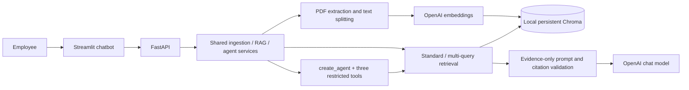

# Mini-Project — IronStore Enterprise AI Assistant

Build an AI-powered enterprise assistant that enables employees to access internal company knowledge through natural language.


## Your task:

- Build an AI assistant that helps employees quickly access internal company knowledge through a conversational interface.
- The assistant should answer questions, explain internal procedures, and assist with everyday work tasks by using the organization's proprietary information. It should provide clear, accurate, and trustworthy responses, helping employees find information efficiently while acknowledging when it cannot confidently answer a question.
- The goal is to create a practical internal assistant that improves productivity, reduces time spent searching for information, and provides a consistent experience across the organization.


## The data

Your team has collected a set of internal company documents from different departments.

These documents are available in the `documents` directory. 

Before you start building the assistant, inspect the documents to understand what information they contain, how they are structured.

The dataset has been synthetically generated, as this type of internal company information is typically not publicly available. However, it has been designed to be as realistic as possible and to resemble the kinds of documents you would encounter in a real organization.

Keep in mind that, as with many real-world document collections, the data may contain inconsistencies, duplicated content, or outdated information. Your solution should handle these situations as effectively as possible.

---

## Implemented application — IronStore knowledge assistant

The assignment above and its supplied data are preserved. This application helps employees
find company procedures through evidence-based conversational answers instead of manually
searching department PDFs. It is an **educational MVP**, with no enterprise authentication
or access controls. Use synthetic documents on a trusted local machine.

### Features and stack

- PDF, UTF-8 TXT and Markdown ingestion; page-aware recursive splitting; file and content validation.
- OpenAI embeddings in persistent local Chroma, SHA-256 document deduplication and stable chunk IDs.
- Grounded RAG answers with source passages, page numbers, citation ID validation and explicit abstention.
- Standard similarity and multi-query retrieval with generated queries and a comparison of retrieved chunks.
- Modern LangChain v1 `create_agent` with typed `search_documents`, `summarize_document`, `list_documents` tools.
- Streamlit conversation history, uploads, three modes, loading indicators and clear chat.
- FastAPI/Pydantic API, offline Pytest coverage, synthetic demonstration documents and repeatable evaluation.

Python 3.12; LangChain v1 with OpenAI/Chroma integrations; `gpt-4o-mini` chat;
`text-embedding-3-small` embeddings; ChromaDB; FastAPI; Streamlit; Pydantic;
python-dotenv; pypdf; Pytest. Exact tested dependencies are in `requirements.txt`;
`requirements.in` records the intended compatible major-version ranges.



### Install in Windows PowerShell

From this repository's root, with Python 3.12 installed:

```powershell
python --version
python -m venv .venv
.\.venv\Scripts\Activate.ps1
python -m pip install -r requirements.txt
python -m pip check
Copy-Item .env.example .env
notepad .env
```

If activation is blocked by your PowerShell policy, use `.\.venv\Scripts\python.exe`
in place of `python` in every command below; activation is optional.

Set `OPENAI_API_KEY` to your own key in `.env`. Keep that file private and untracked.
Defaults:

```dotenv
OPENAI_API_KEY=
OPENAI_CHAT_MODEL=gpt-4o-mini
OPENAI_EMBEDDING_MODEL=text-embedding-3-small
CHROMA_PERSIST_DIRECTORY=./data/chroma
API_BASE_URL=http://127.0.0.1:8000
```

Models are configured centrally, not across individual modules. Changing embedding model
or chunk settings selects another Chroma collection: ingest documents again. Restart
the API after changing configuration. Missing credentials produce a useful HTTP 503
configuration message. `/health` remains available without a key.

**Data processing:** uploaded text is sent to OpenAI for embeddings; questions, conversation
context and retrieved passages are sent for chat/expansion/agent calls. Vector storage is
local, but inference is external and incurs API charges. The UI discloses this before upload.

### Index documents and start the app

Start with the three tiny synthetic demo policies:

```powershell
python -m scripts.ingest_sample_data
python -m uvicorn app.main:app --host 127.0.0.1 --port 8000
```

In a second PowerShell terminal at the repository root:

```powershell
.\.venv\Scripts\Activate.ps1
python -m streamlit run ui/streamlit_app.py
```

Open [the chatbot](http://127.0.0.1:8501) and [interactive API documentation](http://127.0.0.1:8000/docs).
Select PDF/TXT/MD files in the sidebar and click **Index documents**. Limits default to
10 MB per file and 2 million extracted characters. Scanned PDFs need OCR beforehand.
Exact repeated bytes are skipped, including files renamed after first ingestion.

To use the original assignment's 83 PDFs, stop the API, then use a separate database:

```powershell
$env:CHROMA_PERSIST_DIRECTORY = './data/chroma-assignment'
python -m scripts.ingest_sample_data --assignment
python -m uvicorn app.main:app --host 127.0.0.1 --port 8000
```

The ZIP is read directly without extracting filesystem paths; macOS metadata is ignored.
This indexes the supplied policies and catalogs and may cost more than the tiny demo.
Do not mix the added demo policies with assignment PDFs when assessing policy correctness.
Use one API worker and avoid concurrent CLI writes while the API runs.

### Use the chatbot

Choose **Standard** for one similarity search. Choose **Multi-query** to generate up to
three alternative queries, deduplicate their results and see the original-versus-union
comparison in **Retrieval details and comparison**. Choose **Agent** for tool selection,
such as “List the available documents” or “Summarize the remote work document.”

Follow-ups such as “Who approves it?” are rewritten using the last conversation turns.
Visible history stays in the current session; **Clear chat** resets it. Up to 20 recent
turns are sent per request. Source expanders show exact document passages, pages and chunk
IDs; these IDs link the answer to retrieved evidence. No general-knowledge fallback is used.

With only the small demo policies indexed:

| Question | Expected behavior (not a recorded model result) |
|---|---|
| How many remote days are allowed each week? | Explain the two-day rule and manager approval; cite remote_work.md. |
| When should I submit an expense claim? | Explain the 30-day deadline; cite expenses.md. |
| What should I do if I lose my company laptop? | Describe reporting to IT; cite it_security.txt. |
| What was the audited profit in 2025? | State that available documents do not establish an answer. |
| List available documents. (Agent) | Call the document inventory tool and show indexed names. |

For assignment PDFs, ask about leave requests, password resets, shipping SLAs or product
specifications. Ask explicitly about review dates when comparing historical material.
The model is instructed to disclose conflicts; automated version precedence is not implemented.

### API

| Endpoint | Purpose |
|---|---|
| `GET /health` | Liveness and whether a key is configured; no network call. |
| `GET /documents` | Document IDs, names and chunk counts. |
| `POST /documents/upload` | Multipart `file`; returns document ID, count and duplicate flag (201). |
| `POST /documents/search` | JSON question and standard/multi_query mode; passages, queries and comparison. |
| `POST /chat` | JSON question, standard/multi_query/agent mode and optional bounded history. |

```powershell
Invoke-RestMethod http://127.0.0.1:8000/health
$body = @{ question = 'How many remote work days are allowed?'; mode = 'multi_query'; history = @() } | ConvertTo-Json
Invoke-RestMethod -Method Post -Uri http://127.0.0.1:8000/chat -ContentType 'application/json' -Body $body
```

Invalid inputs return 422; oversized content returns 413; unavailable configuration,
embeddings or storage return 503. Completion failure after successful retrieval returns
an explicit abstention with a warning and passages for manual review. Query expansion
failure falls back to standard retrieval and reports the fallback.

### Tests and evaluation

```powershell
python -m pytest -q
python -m pip check
```

Tests mock external APIs. They exercise real local Chroma storage with deterministic
test vectors, PDF extraction, validation, deduplication, rollback, citation validation,
provider failures, an actual LangChain agent tool loop, FastAPI and Streamlit interactions.
They do not establish OpenAI answer quality.

On a clean demo database with real credentials:

```powershell
python -m scripts.ingest_sample_data
python -m scripts.evaluate --mode standard
python -m scripts.evaluate --mode multi_query
python -m scripts.evaluate --mode multi_query --answers
```

The evaluation dataset has five answerable questions with expected source documents and
two insufficient-information questions. Retrieval hit rate counts whether an expected
document appears in the results, only over answerable cases. Optional answer evaluation
reports abstention on insufficient cases. It excludes provider-failure abstentions from
successes. Results are printed as JSON; no scores are invented. With only three demo
documents and k=5, hit rate is an easy smoke test, not a meaningful production benchmark.

Observed execution results and unverified items are recorded in [the verification report](docs/verification.md).
No live OpenAI answer or evaluation score is claimed without credentials and an actual run.

### Trade-offs, security and future work

This small, single-machine project uses Chroma rather than Elasticsearch or Pinecone to
avoid search-cluster or managed-service setup. Elasticsearch offers future hybrid search;
Pinecone offers managed scaling. One model and one agent with three tools keep cost and
debugging manageable compared with complex multi-agent routing.

Source IDs are validated against real chunks, but the model may still misinterpret text
or miss a competing policy. A prompt is not a proof of grounding or a complete defense
against prompt injection. File hashes detect exact binary duplicates, not semantic ones.
Large summaries disclose truncation after an initial 24,000-character context budget.
No OCR, reranking, automatic policy precedence, deletion UI or persistent chat archive.

There is no authentication, authorization, tenant isolation, malware scanning, rate limiting
or hardened PDF sandbox. Bind to localhost and use trusted synthetic files. Never treat
this as a secured enterprise deployment. Future work: identity and role-based access,
version/retention management, hybrid retrieval/reranking, audited conflict resolution,
human-reviewed groundedness evaluation and robust document processing isolation.

See [architecture](docs/architecture.md), [design decisions](docs/design_decisions.md),
and [the implementation plan](docs/implementation_plan.md). Original assignment files
are retained; no commits, pushes or pull requests are created automatically.
