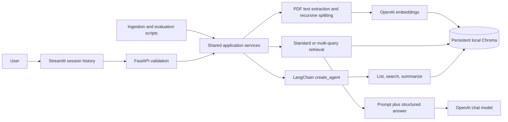

# Architecture

Run one API worker bound to localhost. Only the API process owns the production Chroma
client; the UI is an HTTP client. Stop the API before using CLI ingestion concurrently.
Each request builds its own agent evidence dictionary, so tool results cannot leak
between conversations. History comes from the current Streamlit session, is bounded,
and is used to rewrite follow-up questions before searching.

Uploads remain in memory. UTF-8 TXT/Markdown and unencrypted text PDFs are supported.
PDF pages are split independently so citations preserve page numbers. SHA-256 hashes
of file bytes identify documents; `<hash>:<index>` identifies chunks. Duplicate byte
content under a different filename keeps the original name. A per-process lock serializes
ingestion, and failed writes delete the document's chunks. Re-ingesting modified bytes
creates another version. This is deliberately not a full document version registry.

Collections are keyed by embedding model and chunking settings. Changing either selects
a new collection that must be populated again; old collections remain on disk. OpenAI
API credentials are never stored in document metadata or returned by tools.

Multi-query retrieves the original question and at most three generated variants, then
unions results by stable chunk ID. The UI shows original-result and union counts/IDs,
queries and source passages. This comparison measures coverage, not correctness. Results
are not reranked, and the union may include irrelevant passages.

The answer model returns a Pydantic object with source IDs and an insufficiency flag.
Any unknown ID rejects the answer. Citations are constructed from stored metadata, not
from model-generated filenames. This prevents invented source records but cannot prove
every generated sentence follows from the cited passage. Evidence text may contain
malicious instructions: prompts explicitly treat it as untrusted data. This is a defense,
not a guarantee against prompt injection.

Agent tools have no shell, arbitrary code, URL fetching or file-reading capability.
The agent has a 12-step recursion budget. Its free-form final prose is not exposed:
answers are regenerated from the passages actually returned by tools; inventory responses
are rendered deterministically. Large document summaries disclose that only an initial
24,000-character segment was used.
